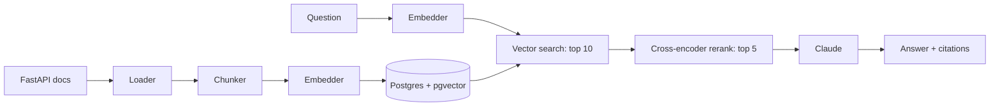

# rag-in-production

A Retrieval-Augmented Generation (RAG) service that answers questions about the [FastAPI](https://fastapi.tiangolo.com) documentation, with citations. Built step by step, with every design decision explained, as a learning and portfolio project.

## How it works



This is the default path. Keyword search with RRF fusion (`hybrid`) and LLM query rewriting exist as opt-in modes, kept because they were measured and did not pay off (see Results).

| Layer | Choice | Why |
|---|---|---|
| Corpus | 48 FastAPI docs pages (43 tutorial + overview pages), pinned to `0.162.0` | Small enough to understand, stable enough to evaluate |
| Chunking | Markdown-structure aware, ~1200 chars, heading path prefix | Never splits code examples; every chunk knows its context |
| Embeddings | `BAAI/bge-small-en-v1.5` via fastembed (local) | No API key, no per-call cost |
| Store | Postgres 16 + pgvector, HNSW index | One database for text, metadata and vectors |
| Retrieval | `vector`, `hybrid` (+ Postgres full-text, RRF), `rerank` (cross-encoder), or both | Each idea measured separately on the golden set before it becomes the default |
| Generation | Claude, sources-only prompt with `[n]` citations | Grounded answers that can be verified |
| API | FastAPI | `POST /ask`, `GET /health` |

## Results

Every design decision was measured on a golden set (47 answerable + 6 unanswerable questions) instead of assumed.

**Retrieval** (42-question set, answer chunk in the top 5; full analysis in [2b](docs/learning/02b-hybrid-search-rerank.md)):

| Mode | Found in top 5 | MRR | Latency (p50) | vs. vector |
|---|---|---|---|---|
| `vector` (baseline) | 38 / 42 | 0.759 | 8 ms | |
| `hybrid` (keywords + RRF) | 38 / 42 | 0.719 | 11 ms | fixed 1, broke 1 |
| `rerank`, 30 candidates | 37 / 42 | 0.720 | 620 ms | fixed 3, broke 4 |
| `rerank`, 10 candidates (**default**) | **40 / 42** | 0.746 | 163 ms | fixed 2, broke 0 |

On the later 47-question set the default beats vector 91.5% to 89.4%.

**Models** (same 5 sources for every model, Opus as judge; full analysis in [2c](docs/learning/02c-answer-evals.md)):

| Model | Correct | Unfaithful | Cost / question |
|---|---|---|---|
| Haiku 5.5 | 78.6% | 9.8% | $0.0004 |
| **Sonnet 5.5** (default) | 90.5% | 0% | $0.007 |
| Opus 5.5 | 90.5% | 5.0% | $0.016 |

The quality bar was fixed before looking at results: unfaithful at most 5%, every unanswerable question refused, correct at least 80%. Sonnet is the cheapest model that passes.

**What the measurements said**
- Keyword search did not help on natural-language docs. A reranker on 30 candidates hurt; on 10 it helped.
- LLM query rewriting looked like a fix in one run and did nothing in the next: LLM output varies per run, so one run proves nothing. It stays opt-in.
- Similarity scores cannot tell whether an answer exists: a question with no answer scored higher (0.765) than one whose answer was in the docs (0.729). The model is instructed to answer only from the sources and to refuse otherwise.
- A Docker healthcheck found a crash in `/health` that the tests had missed. There is now a test for the API layer.

## Quick start

Requires Docker, [uv](https://docs.astral.sh/uv/) and an [Anthropic API key](https://console.anthropic.com).

```bash
cp .env.example .env      # add ANTHROPIC_API_KEY
make install
make up                   # Postgres + pgvector
make ingest               # download, chunk, embed, store
make ask Q="How do I make a query parameter optional?"
make api                  # http://localhost:8000/docs
make eval-retrieval        # search quality per retrieval mode, no LLM calls
make eval-answers          # answer quality + cost per model, LLM judge (costs ~$4)
# a local model too, with Ollama:  make eval-answers ANSWER_MODELS=claude-haiku-5-5,ollama:llama3.1:8b
# add the LLM query-rewrite mode (costs cents):  make eval-retrieval MODES=vector,rerank,rewrite_rerank

# in containers (Docker): API + Postgres, then fill the index
make docker-up
make docker-ingest
make test
```

## Roadmap

- [x] **Code map.** One-hour reading tour of the whole codebase ([guide](docs/learning/00-code-map.md))
- [x] **Step 1: Foundations.** End-to-end RAG with citations ([explanation](docs/learning/01-foundations.md))
- [ ] **Step 2: Measured quality.**
  - [x] 2a: golden set (47 answerable + 6 unanswerable questions) and retrieval evals ([explanation](docs/learning/02a-retrieval-evals.md))
  - [x] 2b: hybrid search and reranking, four modes compared ([explanation](docs/learning/02b-hybrid-search-rerank.md))
  - [x] 2c: answer evals (LLM-as-judge) and model comparison ([explanation](docs/learning/02c-answer-evals.md))
  - [x] 2d: local models with Ollama in the same comparison ([explanation](docs/learning/02d-local-models.md))
  - [x] 2e: query rewriting, measured: no gain in hit@5, kept opt-in (a useful negative result, [explanation](docs/learning/02e-query-rewriting.md))
  - [x] 2f: overview pages in the corpus + 6 new golden questions (old 42 questions unchanged after adding them) ([explanation](docs/learning/02f-corpus-overview-pages.md))
- [ ] **Step 3: Production.** Tracing, cost tracking, caching, auth, rate limiting, prompt-injection defenses, Docker, CI, cloud deploy ([3a Docker and CI](docs/learning/03a-docker-ci.md): done, the image builds and CI runs the tests against a real Postgres; [3b-1 auth and rate limit](docs/learning/03b-auth-rate-limit.md): done)
- [ ] **Step 4: Write-up.** Architecture, results, and the trade-off behind every decision
