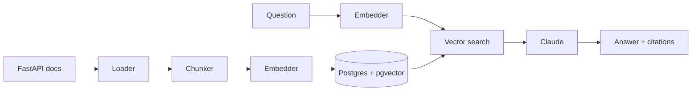

# rag-in-production

A Retrieval-Augmented Generation (RAG) service that answers questions about the [FastAPI](https://fastapi.tiangolo.com) documentation, with citations. Built step by step, with every design decision explained, as a learning and portfolio project.

## How it works



| Layer | Choice | Why |
|---|---|---|
| Corpus | 43 FastAPI tutorial pages, pinned to `0.162.0` | Small enough to understand, stable enough to evaluate |
| Chunking | Markdown-structure aware, ~1200 chars, heading path prefix | Never splits code examples; every chunk knows its context |
| Embeddings | `BAAI/bge-small-en-v1.5` via fastembed (local) | No API key, no per-call cost |
| Store | Postgres 16 + pgvector, HNSW index | One database for text, metadata and vectors |
| Generation | Claude, sources-only prompt with `[n]` citations | Grounded answers that can be verified |
| API | FastAPI | `POST /ask`, `GET /health` |

## Quick start

Requires Docker, [uv](https://docs.astral.sh/uv/) and an [Anthropic API key](https://console.anthropic.com).

```bash
cp .env.example .env      # add ANTHROPIC_API_KEY
make install
make up                   # Postgres + pgvector
make ingest               # download, chunk, embed, store
make ask Q="How do I make a query parameter optional?"
make api                  # http://localhost:8000/docs
make test
```

## Roadmap

- [x] **Step 1: Foundations.** End-to-end RAG with citations ([explanation](docs/learning/01-foundations.md))
- [ ] **Step 2: Measured quality.** Golden set, retrieval and faithfulness evals, hybrid search, reranking
- [ ] **Step 3: Production.** Tracing, cost tracking, caching, auth, rate limiting, prompt-injection defenses, Docker, CI, cloud deploy
- [ ] **Step 4: Write-up.** Architecture, results, and the trade-off behind every decision
