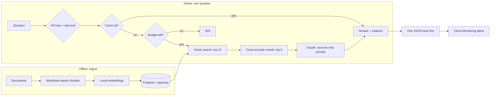

# Case study: a production-grade RAG assistant for a small finance office

**What this is.** A portfolio project and reference implementation, built solo. It is designed around a realistic scenario: a small bookkeeping firm whose staff need fast, cited answers from internal policies and procedures. There was no real client. The system was built and measured end to end on a public corpus (the FastAPI documentation, pinned to version `0.162.0`), because public documents can be shared, versioned and evaluated openly. A synthetic finance-office corpus and golden set ship alongside it to show how the same system maps onto that domain ([examples/finance-office/](../../examples/finance-office/)).

Every number below was measured in this repo. Each one links to the step where it was measured.

## 1. The problem

A small finance office (think 10 to 20 people: partners, bookkeepers, a reviewer, an office manager) runs on internal rules: how long to keep records, who approves a payment of a given size, what to do when a supplier emails new bank details, when the VAT draft is due internally. These rules live in a dozen documents that people half-remember.

The cost of a wrong answer is not a bad user experience. It is a payment approved by the wrong person, a record deleted during an audit, or a client file sent by plain email. So the requirements are different from a chatbot demo:

| Requirement | Why it matters in a finance office |
|---|---|
| Answer only from the firm's documents | A plausible answer from general knowledge is worse than no answer |
| Cite the exact section | Staff and reviewers must be able to check the rule, not trust the model |
| Refuse when the documents do not answer | "I don't know, ask the Finance Lead" is a correct outcome |
| Keep cost bounded and predictable | A small firm cannot absorb a surprise API bill |
| Keep client data out of logs and prompts where possible | Confidentiality is a professional obligation |
| Measure quality before and after every change | You cannot review every answer by hand |

## 2. Why RAG, and not the alternatives

- **Fine-tuning** bakes the rules into weights: no citations, and every policy change means retraining. Policies change several times a year.
- **Putting all documents in the prompt** works for 8 documents and stops working at 50, and costs grow with every question.
- **Keyword search on the shared drive** finds documents, not answers, and fails on paraphrases ("Can I start before the client signs?" vs "engagement letter").
- **RAG** retrieves the few relevant sections, makes the model answer only from them with citations, and picks up a policy change on the next ingest.

## 3. Architecture

| Layer | Choice | Reason |
|---|---|---|
| Chunking | Split by Markdown headings, about 1,200 characters, heading path prefixed | Never splits a code block, keeps short tables whole, and every chunk knows its section |
| Embeddings | `bge-small-en-v1.5`, run locally | No per-question cost and no document text sent to an embeddings API |
| Store | Postgres 16 + pgvector (HNSW) | One database for text, metadata and vectors; 745 chunks do not justify a second system |
| Retrieval | Vector top 10, then cross-encoder rerank to top 5 | Chosen by measurement (section 4) |
| Generation | Claude Sonnet, sources-only prompt, `[n]` citations, exact refusal sentence | Cheapest model that passed a quality bar fixed in advance |
| Guards | `X-API-Key`, rate limit 20/min per key, daily dollar budget, exact-match cache | Cost control and abuse control are separate problems |
| Hosting | Cloud Run (scale to zero, max 2 instances) + Neon serverless Postgres, both in Frankfurt | Pay per request; database next to the API |
| Delivery | GitHub Actions CI with a real pgvector; CD with Workload Identity Federation | No long-lived cloud keys anywhere |

## 4. Key decisions, with the numbers behind them

### 4.1 Build the ruler first

Before optimizing anything, I built a golden set: 53 questions, 6 of them deliberately unanswerable from the corpus, each with the sections that answer it. Two separate evals run on it:

- **Retrieval eval** (cheap, deterministic, no LLM): hit@k, recall@k, MRR, latency.
- **Answer eval** (LLM-as-judge): correct, unfaithful (any claim not in the sources, even if true), correct refusal, phantom citations. Every model gets the same 5 sources, so the comparison is between models, not between searches.

The quality bar was written down **before** the first run: unfaithful at most 5%, every unanswerable question refused, correct at least 80%. It did not move afterwards. ([2a](../learning/02a-retrieval-evals.md), [2c](../learning/02c-answer-evals.md))

### 4.2 Retrieval: measured, not assumed ([2b](../learning/02b-hybrid-search-rerank.md))

42 answerable questions, top 5:

| Mode | hit@5 | recall@5 | MRR | p50 latency | Fixed / broke vs vector |
|---|---|---|---|---|---|
| Vector (baseline) | 0.905 | 0.722 | 0.759 | 8 ms | |
| Hybrid (Postgres full-text + RRF) | 0.905 | 0.667 | 0.719 | 11 ms | 1 / 1 |
| Rerank, 30 candidates | 0.881 | 0.690 | 0.720 | 620 ms | 3 / 4 |
| **Rerank, 10 candidates (default)** | **0.952** | **0.740** | 0.746 | 163 ms | 2 / 0 |

The default fixes two misses and breaks nothing. On the later 47-question set it is 91.5% vs 89.4% for vector. Hybrid search, the usual recommendation, did not help on natural-language questions over prose, and is kept as an opt-in mode.

### 4.3 Model choice: the cheapest model that passes ([2c](../learning/02c-answer-evals.md))

| Model | Correct | Unfaithful | Cost per question | Passes the bar? |
|---|---|---|---|---|
| Haiku 5.5 | 78.6% | 9.8% | $0.0004 | No |
| **Sonnet 5.5** | **90.5%** | **0%** | **$0.007** | **Yes, chosen** |
| Opus 5.5 | 90.5% | 5.0% | $0.016 | At the edge, 2.3x the cost |

Every model refused every unanswerable question in that run. The two questions that all three models missed were retrieval misses: the right section never reached the model. That is a retrieval ceiling, not a model problem.

### 4.4 Refusal is the model's job, not a score threshold ([1](../learning/01-foundations.md))

A question with no answer in the corpus scored **higher** on similarity (0.765) than a question whose answer was there (0.729). Similarity measures "on topic", not "contains the answer". So there is no threshold on the score: the prompt requires an exact refusal sentence, and the eval checks it on the unanswerable questions.

### 4.5 Cost, cache and budget ([3c](../learning/03c-cost-cache-tracing.md))

- A typical question is about 2,500 input and 300 output tokens: roughly $0.007 to $0.008 on Sonnet. Every response returns its own `cost_usd`.
- A daily dollar budget returns 503 once spent ($1/day in the deployed demo). Rate limits cap requests, not dollars, and a leaked key can spend money at a "legal" rate.
- An exact-match cache (LRU, 500 entries, 1 hour TTL) returns a repeat question for $0 in about a millisecond. Not a semantic cache: "make it optional" and "make it required" embed close together and have opposite answers. A wrong cached answer is worse than a slow one.
- One JSON trace line per question: request id, time per stage, cost, cache hit, model, status. The question text itself is not logged, only its length.

### 4.6 Security ([3b-1](../learning/03b-auth-rate-limit.md), [3b-2](../learning/03b2-prompt-injection.md), [3d](../learning/03d-cloud-run-neon.md))

- API keys compared in constant time; the service refuses to start on Cloud Run with no keys configured.
- Prompt injection through a document: source tags neutralized, a system-prompt rule that sources are data, and the model has no tools. A red-team eval with a canary: Sonnet and Haiku resisted 5 of 5 attacks, even with sanitizing turned off. That is a regression net, not proof of safety: 5 attacks is a small sample. The real defense is limiting what a successful injection can do.
- Secrets in Secret Manager with per-secret access; database password redacted from logs; TLS required for any remote database.

### 4.7 Operations ([3d](../learning/03d-cloud-run-neon.md), [3e](../learning/03e-monitoring-alerts.md), [3f](../learning/03f-cd.md))

- Separate liveness (`/health`, no database) and readiness (`/ready`: database answers and the index is not empty).
- Alerts in Cloud Monitoring, built from the trace lines: more than 3 server errors in 10 minutes, p95 latency above 8 seconds, any budget refusal. The budget alert was verified end to end by email.
- `make report` summarizes the deployed service's logs (error rate, p95, cost) and shows which alerts would fire.
- CD: a push to `main` that passes CI is built, deployed as a revision with no traffic, smoke-tested, and only then given traffic. GitHub Actions authenticates with Workload Identity Federation, so there is no key file. The first real run took 1 minute 48 seconds. Rollback is one command to a previous revision.
- About 200 automated tests, run in CI against a real Postgres with pgvector.

## 5. What failed, and what I learned from it

These are the parts I would rather talk about than hide.

| What I tried | What happened | Lesson |
|---|---|---|
| Hybrid search (keywords + RRF) | No gain in hit@5, lower MRR | Popular advice is a hypothesis. It may help a corpus full of codes and ids; measure there |
| Reranker on 30 candidates | Broke 4 questions that worked | More candidates gave the reranker more ways to be wrong |
| LLM query rewriting | hit@5 0.952 to 0.976 on one run, back to 0.952 on the next, +1.3 s per question | Anything with an LLM in it gets run more than once. Kept opt-in |
| Free local models (Ollama, 1.5B to 8B) | Best, `qwen2.5:3b`: 32% correct, 48% unfaithful, p50 8.4 s on a laptop. 8B froze the machine | "Free" costs time, hardware and quality. Measured, then rejected |
| First cloud deploy | After 5 idle minutes every question returned 500 | Neon's free tier suspends and closes connections; the service held one stale connection. Reproduced on purpose, then fixed with a reconnect-and-retry-once, verified after 9+ idle minutes |
| A green test suite | A Docker healthcheck found a crash in `/health` the tests missed | The API layer had no tests. It does now |
| Measuring local-model latency | First numbers were 4x too high | The eval sent 4 requests in parallel to a server that answers one at a time. Check the ruler before comparing |

## 6. Known limits

- **No real users or traffic.** Quality numbers come from a 53-question golden set, not from production usage.
- **The judge is only lightly calibrated.** I checked 3 verdicts by hand and agreed with 2. Tooling for a blind human-labeling pass with Cohen's kappa exists in `src/rag/evals/`; the measurement itself is not done yet.
- **State is per instance.** Cache, budget and rate limit live in memory, which is acceptable with at most 2 instances and wrong at scale.
- **One database connection per instance**, not a pool.
- **The finance-office corpus has not been evaluated yet.** It is ready (section 7), but no numbers are claimed for it.

## 7. Mapping to the finance-office scenario

The detailed mapping is in [finance-office-mapping.md](finance-office-mapping.md). In short:

- **Already fits as built:** sources-only answers with section-level citations, exact refusal, local embeddings, no question text in logs, dollar budget, alerts, keyless deploy, versioned re-ingest that deletes removed documents.
- **Would change for a real firm:** document loaders for Word and PDF, per-document access control enforced inside the database query, an audit log of who asked what and which sections were shown, PII redaction at ingest, SSO instead of API keys, a "who to ask" escalation in the refusal, and a golden set written with the firm's own staff.

## 8. What I would do next, in order

1. Run the retrieval and answer evals on the finance-office corpus, and test the hypothesis that hybrid search helps there (codes like `CL-0142` and account `9999` are exactly what keyword search is good at).
2. Finish the human-labeling pass and report judge agreement.
3. Per-document access control as a `WHERE` clause in the vector query, with a test that a bookkeeper never retrieves a restricted section.
4. An audit log table, separate from the operational trace, with its own retention.
5. A small eval set as a CI gate when the prompt, model or retrieval changes.
6. Redis for shared state and a connection pool, when there is more than one instance's worth of traffic.
